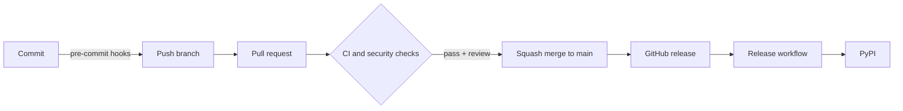

# Architecture

How the pieces of this template fit together. For day-to-day commands, see [development](development.md). For one-time repository settings, see [repository setup](repo-setup.md).

## Overview

A change moves through three layers of checks before it reaches `main`, and a release moves through one more before it reaches PyPI.



## Layers

| Layer | What runs | Where |
| --- | --- | --- |
| Local | gitleaks, file hygiene, markdownlint, Ruff, `uv lock` check, mypy, Sweepito scan and cleanup | pre-commit hooks |
| Pull request | `ci` (lint, unit and integration tests on Python 3.11 to 3.15 on Ubuntu plus 3.11 on Windows and macOS, build), dependency review, CodeQL | GitHub Actions |
| Repository | Branch ruleset, secret scanning with push protection, Dependabot alerts and updates | GitHub settings |
| Release | Version check, build, trusted publish to PyPI | `release.yml` |

## Source layout

```text
src/example_package/   typed package (src layout, py.typed)
tests/                 pytest unit tests with coverage (80% minimum)
tests/integration/     tests marked `integration`: skipped by default and in pre-commit, run in CI
pyproject.toml         metadata, dev dependencies and tool configuration
uv.lock                locked dependency set, checked by CI with --locked
```

The version lives in one place, `__version__` in the package, and Hatchling reads it at build time. The release workflow compares it with the release tag.

## Workflows

| Workflow | Trigger | Purpose |
| --- | --- | --- |
| `ci.yml` | Pull request, push to `main` | Runs `lint`, `test`, `integration` and `build` in parallel. A final `ci` job gates on all four and is the only check the ruleset requires. |
| `dependency-review.yml` | Pull request | Blocks pull requests that add vulnerable dependencies. |
| `audit.yml` | Weekly, manual, and pull requests that change `uv.lock` | Runs `pip-audit` on the locked dependencies to catch newly published vulnerabilities. |
| `release.yml` | GitHub release published | Checks the tag matches the version, builds, then publishes to PyPI. |
| `init.yml` | Manual | One-time placeholder replacement in a repo created from the template. Skipped in the template itself. |

CodeQL runs through GitHub's default setup rather than a workflow file.

## Branch governance

The `main` ruleset in `.github/rulesets/main.json` is applied by `scripts/apply_repo_settings.py`. It requires:

- a pull request with a code owner review and resolved conversations, squash merge only
- the `ci` and `dependency-review` checks, with the branch up to date
- CodeQL results
- no deletion and no force push

Repository admins can bypass through a pull request so a solo maintainer is not locked out.

## Release flow

1. Bump `__version__` and update `CHANGELOG.md` in a pull request.
2. After merge, publish a GitHub release tagged `v<version>`.
3. `release.yml` builds the sdist and wheel in one job, then a second job in the `pypi` environment publishes them using OpenID Connect. No API token is stored, and only the publish job gets the `id-token` permission.

## Template lifecycle

GitHub copies files, not settings. A new repo therefore needs three steps: run **Init** to replace the template owner and name, rename the example package, and run the settings script to apply protections and the ruleset.
